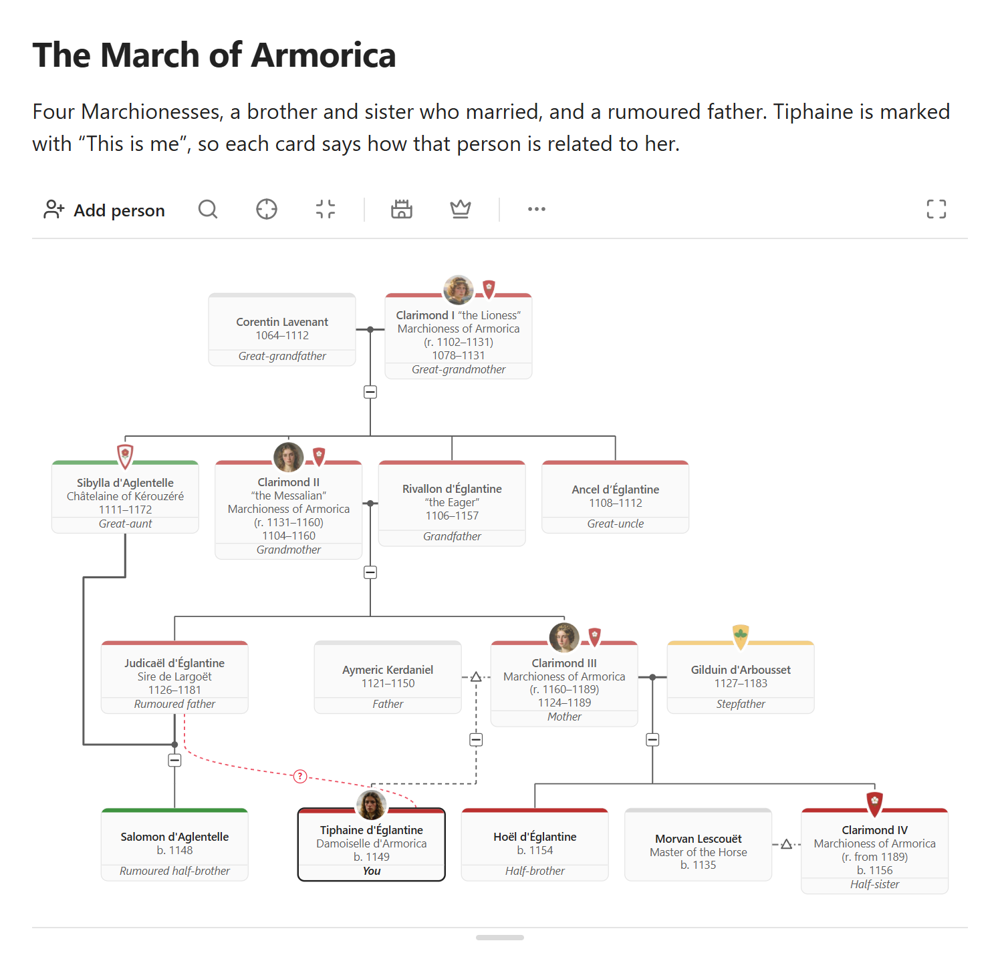
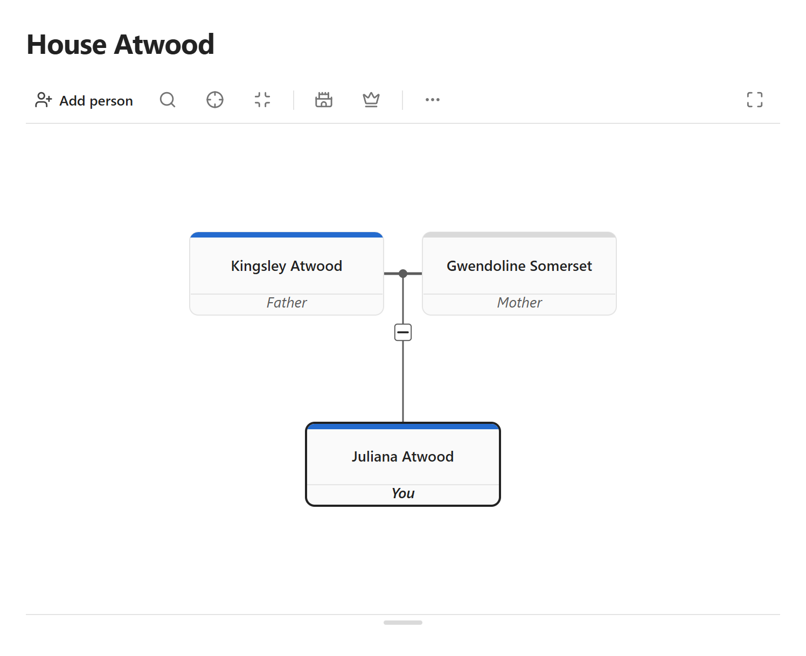

# Crown and Kin

Crown and Kin is a plugin for Obsidian. It draws the family tree of a noble house, for a strategy game or a role-play game. You change the tree with clicks and taps, on a computer and on a phone. The tree is plain text in your note, so you can also edit it by hand. Your tree stays in your vault.

<picture>
  <source media="(prefers-color-scheme: dark)" srcset="docs/images/hero-dark.png">
  
</picture>

## Install

You need Obsidian 1.11 or newer. The plugin is not in the Obsidian list of community plugins yet. Install it from the release files on GitHub.

1. Open the newest release on the Releases page of this repository.
2. Under "Assets", download the three files `main.js`, `manifest.json` and `styles.css`. Do not download the "Source code" files.
3. Open the folder of your vault on your computer.
4. Show the hidden folders. On Windows, open View, then Show, then Hidden items. On a Mac, press Cmd+Shift+. in Finder.
5. Open the folder `.obsidian`, then `plugins`. If there is no folder `plugins`, make one. Make a folder `crown-and-kin` there. Put the three files in it.
6. In Obsidian, open Settings, then Community plugins. If Obsidian shows "Restricted mode", select "Exit Restricted mode" (Obsidian 1.14) or "Turn on community plugins" (Obsidian 1.11).
7. Select Reload plugins (the button with two arrows).
8. Turn on the switch of Crown and Kin.

If Obsidian shows the window "Do you trust the author of this vault?", select "Trust author and enable plugins". The button "Browse vault in Restricted Mode" keeps the plugins off. Obsidian shows this window when it first opens a vault that holds plugin files.

To update the plugin, replace the three files with the files of the newest release. Then close Obsidian and open it again. Keep the file `data.json`: it holds your settings.

**On a phone,** install the plugin on your computer first. Then let your sync copy the vault to the phone. Obsidian Sync copies plugins only if "Installed community plugins" is on in its settings. Then, on the phone, open Settings, then Community plugins, and turn on Crown and Kin.

## Your first tree

1. Open a note. If the vault has no note, press Ctrl+N (Cmd+N on a Mac) to make one.
2. Put the cursor on an empty text line below a heading or other text. In a new note, type a heading and press Enter.
3. Open the command list (Ctrl+P, or Cmd+P on a Mac). Select "Insert family tree". An empty tree shows in the note.
4. Select "Add first person". Type a name. Select Save.
5. Click the card. On a phone, tap the pencil on the row of the person. The person window opens.
6. Open the section Family. At Partners or Children, select Add, then "New person". If the person has a partner, a first window asks for the other parent of the child. Select the partner or "No other parent". Type a name. Select Save.
7. Repeat steps 5 and 6 until the family is complete.
8. In the person window of the person who is you (or your character), open the section Actions. Select "This is me". Each card now shows its relation to you, for example "Mother" or "Second cousin".
9. Select Expand above the tree. The tree fills the window.
10. To move the tree, drag it. To zoom, hold Ctrl and turn the mouse wheel. On a phone, zoom with two fingers. To close the view, select the X button or press Esc.
11. To reverse a change, select Undo in the person window, or run the command "Undo last tree edit".

<picture>
  <source media="(prefers-color-scheme: dark)" srcset="docs/images/first-tree-dark.png">
  
</picture>

## What else the plugin does

Each feature has its own button or window.

- **Relations.** After "This is me", every card shows its relation to you. More (the "⋯" button), then Relation, shows the relation between any two people and the steps between them.
- **Titles and succession.** The Titles button (the crown) holds the titles, their holders and their reigns. Choose a rule of succession, and the plugin works out the line of succession from the tree.
- **Calendars.** More, then Calendars, opens the calendars of your world. The plugin then reads a date such as "the 10th Year of the Third Cycle". A plain year, for example 1203, needs no setup.
- **Houses and arms.** The Houses button (the castle) gives a house its name, colour and coat of arms. A person can also have personal arms.
- **Portraits.** In the person window, select the portrait circle. Choose a picture from your vault and the part that the card shows.
- **Find, Focus and folds.** Find selects a person by name. Focus shows the family of one person. The small "−" button below a couple folds a branch.
- **The phone.** On a phone, a tree in a note shows as a list: one person and the family of that person. Tap Expand to see the tree.
- **Save as picture.** More, then Save as picture, saves the tree as a PNG or SVG picture in the attachment folder.
- **Settings.** Open Settings, then Crown and Kin. There you set the height of a tree, the direction of the tree on a phone held upright and what the cards show.

## The tree text

The tree is text in a code block with the language `kin`. Each person has an `id`, a short name that the other text lines use. When you change the tree in a window, the plugin changes only the text lines that must change. It keeps your comments.

````markdown
```kin
houses:
  - id: atwood
    name: Atwood
    color: "#246BCE"

people:
  - id: p1
    name: Kingsley Atwood
    house: atwood
    sex: m
  - id: p2
    name: Gwendoline Somerset
    sex: f
  - id: p3
    name: Juliana Atwood
    house: atwood
    sex: f
    parents: [p1, p2]

unions:
  - partners: [p1, p2]
```
````

[docs/format.md](docs/format.md) lists every key, the ways to write it that the plugin accepts, and the way that it writes it.

## FAQ

**I see the text of the tree and not the tree.**
Check that the plugin is on in Settings, then Community plugins. In Live Preview, Obsidian shows the text of a block while the cursor is in it. Keep an empty text line or a heading above a tree. If a tree is the first thing in a note, Live Preview opens the note with the cursor in the tree. Then you see the text of the tree, not the tree. To see the tree, move the cursor out of the tree.

**Can I use the same vault on two devices?**
Yes. If you use the same vault on two devices, wait until the sync is complete before you edit a tree on the other device. If you do not wait, the other device changes an old copy of the note, and the sync can lose one of the two edits. Install the same version of the plugin on every device.

**My calendar dates show no year.**
A tree uses a calendar only if it names a calendar note. Open the tree. Select More, then Calendar note, then your note. Do this for each tree with dates in your own calendar.

## Limits

- **Size.** A tree of more than 1,500 people shows a bar with "Draw the tree" first. The plugin draws a whole tree of up to 5,000 people (3,000 on a phone). For a larger tree, it shows the family of one person.
- **Embeds and Canvas.** A tree shows inside another note, in a hover preview and on a Canvas card. You cannot edit it there. Open the note of the tree.
- **Relation words ignore the years of a marriage.** A husband who divorced still shows as "Husband". Some relations by marriage have no name. More, then Relation, then shows the steps.
- **No drag.** You cannot drag a card to a new place. Change the order of brothers and sisters in the person window.
- **No import or export.** The plugin reads no GEDCOM file and makes no PDF file. To print the tree, save it as a picture.
- **Devices.** The author tested the plugin on Windows and on an iPhone. The author did not test it on Android.
- **Obsidian Publish** shows the tree text, not the tree. The links inside a tree do not show in backlinks or in the graph view.

## Privacy

The plugin does not use the internet. It sends no data and collects no data about you. It never deletes a note or a picture.

It reads the notes in your vault to find the trees and the calendar notes, and it reads the pictures that a tree links to. It writes only three things: the tree text that you change in a window, the calendar note, and a note or a picture that you make with a button. After you rename a note or a picture, it also updates the links in your trees. You can turn off this update in the settings. It keeps its settings in `.obsidian/plugins/crown-and-kin/data.json`.

## Report a problem

Open the Issues tab of this repository and select New issue. Use the form "Bug report" for a fault, or "Feature request" for an idea. A report is public: use invented names in the tree text that you post.

## Licence

Crown and Kin is free software under the GNU General Public License, version 3 only (the file `LICENSE`). [CHANGELOG.md](CHANGELOG.md) lists the changes of each version.
